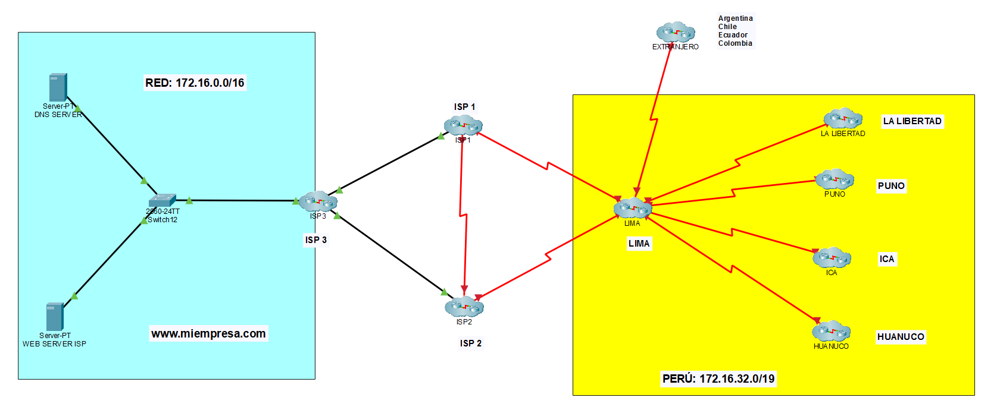
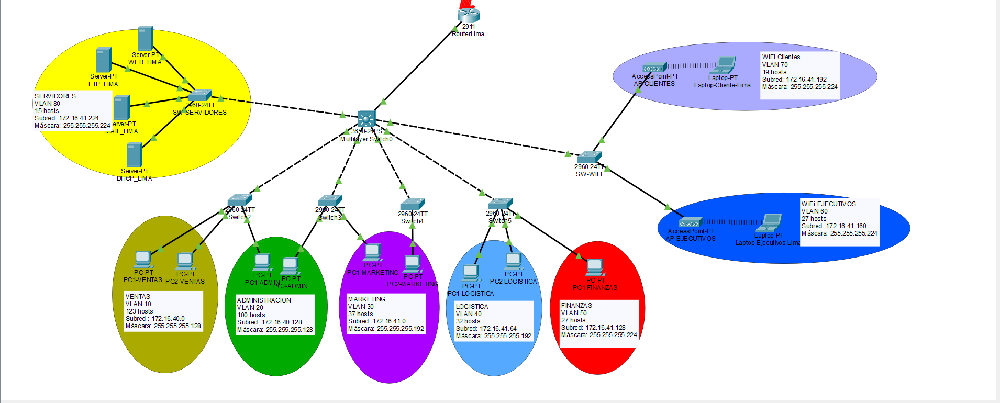
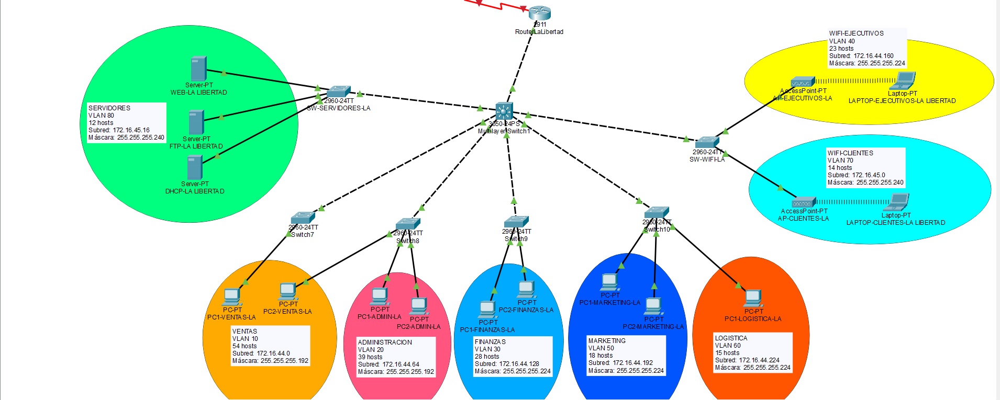
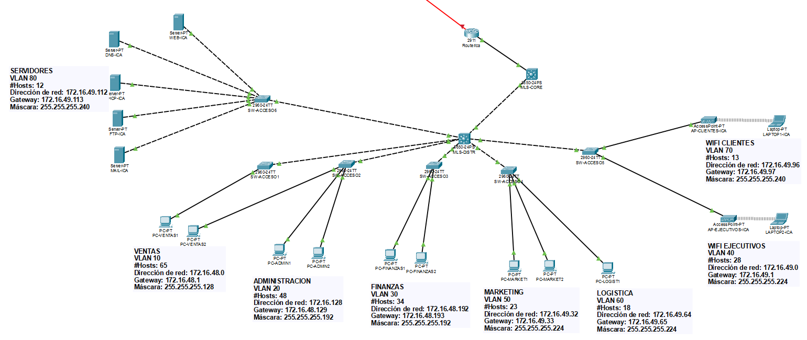
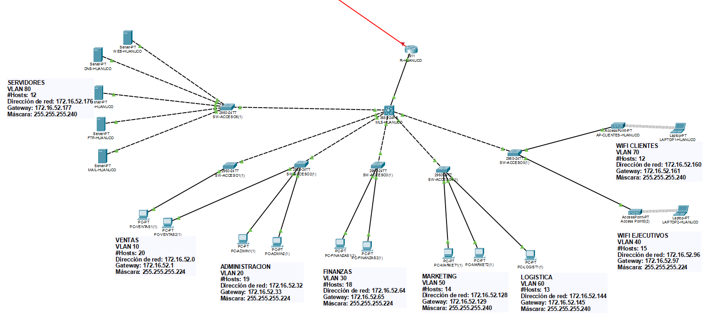
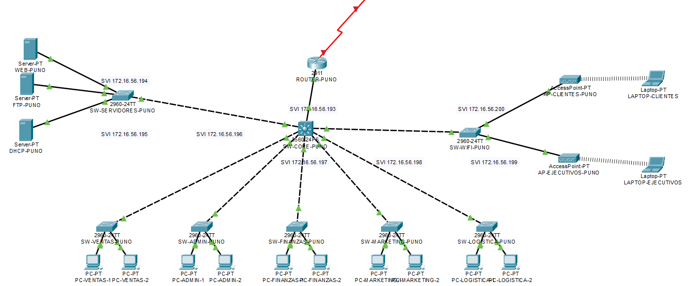

# Red corporativa MIEMPRESA — Entrega parcial (hito 1)

> **Estado: entrega parcial.** Este repositorio contiene el primer hito del trabajo (diseño e implementación de las redes LAN y WLAN). La versión final, con la red WAN y los servicios, se publicará aquí mismo.

Trabajo grupal (3 integrantes) del curso **Redes y Comunicación de Datos** de Ingeniería de Sistemas de Información, UPC (2026-20).

## El caso

MIEMPRESA es una empresa transnacional con casa matriz en Perú y filiales en Argentina, Chile, Ecuador y Colombia. Su red creció diez años sin planificación: equipos de distintos fabricantes, sin documentación y con direcciones IP duplicadas al integrar sedes nuevas. El trabajo diseña e implementa la red de la casa matriz en Perú: **Lima** (sede principal) y las sucursales de **La Libertad, Ica, Huánuco y Puno**.

## Qué se hizo en este hito

- **Direccionamiento jerárquico** desde `172.16.0.0/16`: FLSM a `/19` por país, FLSM a `/22` por sede y VLSM por unidad organizacional, con 25 % de crecimiento a 10 años. Todas las subredes fueron verificadas por script (sin solapamientos, dentro de su sede y con el prefijo mínimo que contiene los hosts). Ver [direccionamiento.md](direccionamiento.md).
- **Diseño LAN jerárquico** (núcleo, distribución y acceso) en cada sede, con 9 VLAN: Ventas, Administración, Marketing, Logística, Finanzas, Servidores, WiFi Ejecutivos, WiFi Clientes y VLAN nativa/gestión.
- **Enlaces troncales 802.1Q** entre switches y **enrutamiento InterVLAN** con SVI en switches multicapa (Lima, La Libertad, Ica, Huánuco) y **Router-on-a-Stick** en Puno.
- **Redes inalámbricas** separadas por VLAN, protegidas con WPA2-PSK/AES.
- **Topología WAN** hub-and-spoke (Lima como hub, con salida a ISP1/ISP2 y al router EXTRANJERO), cableada y lista para configurarse en el hito 2.
- **Pruebas de conectividad** intra VLAN, inter VLAN e inalámbricas en las cinco sedes, todas exitosas (en algunas, el primer ping inter VLAN pierde un paquete por ARP).
- **Dimensionamiento y valorización** (912 puntos de red, 42 switches de acceso, ≈ USD 202 902) y comparación de proveedores cloud para backup (AWS, Azure y Google Cloud; se eligió AWS).

Simulado en **Cisco Packet Tracer**.

## Topología

| WAN | Lima |
|---|---|
|  |  |

| La Libertad | Ica |
|---|---|
|  |  |

| Huánuco | Puno (Router-on-a-Stick) |
|---|---|
|  |  |

## Estructura del repositorio

```
redes-miempresa/
├── README.md
├── direccionamiento.md   # FLSM, VLSM por sede, VLAN y enlaces WAN planificados
├── img/                  # topologías WAN y LAN por sede
└── configs/              # show running-config de routers y switches (sin contraseñas)
```

## Mi aporte

> **[COMPLETAR]** Escribe aquí 2 o 3 líneas con lo que hiciste tú (por ejemplo: qué sedes configuraste, quién hizo el direccionamiento, qué probaste).

## Pendiente para la versión final

- Enlaces WAN con PPP (PAP/CHAP) y enrutamiento RIPv2 entre sedes.
- Rutas estáticas hacia ISP1/ISP2 con ruta flotante de respaldo.
- Servicios DHCP en todas las sedes (hoy solo Puno lo usa para los clientes WiFi).
- Homologar los identificadores de VLAN de Lima con los de las sucursales y poner nombres de host descriptivos.
- Endurecer todos los equipos (contraseñas cifradas, SSH, banner, puertos sin uso apagados, PortFast y BPDU Guard); hoy solo Puno cumple el modelo completo.

## Nota sobre credenciales

Las contraseñas, los hashes `enable secret` y las claves WPA2 del laboratorio **no se publican**: en las configuraciones aparecen como `<REMOVIDO>`.
